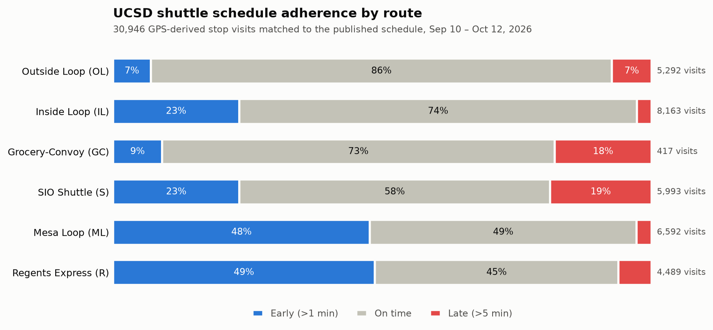

# TritonETA 🚎

[](https://github.com/sharonkodali/tritoneta/actions/workflows/dbt_build.yml)

**Real-time data pipeline and arrival-time modeling for UC San Diego shuttles.** UCSD's live transit feed reports where each shuttle is, but not whether it's late. TritonETA derives that: it turns raw GPS pings into a stop-level delay metric, a reliability scorecard, and a labeled training set for predicting arrival times.



## What's built

| | |
| --- | --- |
| **Data collected** | 180K+ GPS events from 28 shuttles on 6 routes (Sep 10 – Oct 12, 2026), plus scheduled collection via GitHub Actions |
| **Delay metric** | Stop passages interpolated along GPS segments at 61 stops, then each vehicle lap matched to its best scheduled trip |
| **Warehouse** | 15 dbt models on DuckDB (staging → intermediate → marts) with 29 data tests, run in CI |
| **Results** | 30,946 stop visits matched to the schedule (88%); 63% on time overall, from 86% (Outside Loop) to 45% (Regents Express) |
| **ML-ready output** | 27,166-row training set with leakage-safe features and a time-based train/test split |

Full methodology, lineage diagram, and known limitations: **[docs/data-pipeline.md](docs/data-pipeline.md)**.

## Run it

```bash
python -m venv .venv && source .venv/bin/activate
pip install -r requirements-data.txt
cd dbt && dbt build --profiles-dir . && cd ..   # builds all models, runs all tests
python analysis/plot_route_reliability.py         # regenerates the chart above
```

## Architecture

```text
GTFS-Realtime feed ──(poller / GitHub Actions, every 20s)──▶ Parquet
GTFS static schedules (per quarter) ─────────────────────────▶ data/gtfs/
                         │
                         ▼
          dbt on DuckDB: staging → stop passages → runs → delays
                         │
          ┌──────────────┼───────────────┐
          ▼              ▼               ▼
   fct_stop_delays  agg_route_stop_  eta_training_set.parquet
                    performance          │
                                         ▼
                               ETA model → API → web app (in progress)
```

## 👥 Team

**3-person team**

- **Data Engineering:** data ingestion, database, pipelines, GTFS processing
- **ML / Data Science:** feature engineering, ETA prediction, model evaluation
- **Product / Frontend:** map, routing experience, UI/UX, deployment

## Roadmap

- [x] Real-time GPS collection (local poller + scheduled GitHub Actions)
- [x] GTFS schedule processing across service periods
- [x] Stop-level delay metric and reliability scorecard
- [x] Leakage-safe ETA training set
- [ ] Train and evaluate the arrival-time model against a schedule-only baseline
- [ ] Backend API serving predictions
- [ ] Web app: pick a class building and time, get which shuttle to take and when to leave
