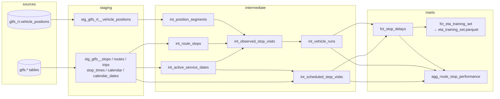

# Data pipeline and lineage

How raw shuttle GPS pings become a stop-level delay metric and a labeled
training set for the arrival-time model.

## Sources

| Source | What it is | Where it lives |
| --- | --- | --- |
| GTFS-Realtime vehicle positions | Live GPS fix per shuttle, polled every ~20 s from the Triton Transit feed (Spare Labs) | `data/raw/positions/*.parquet` |
| GTFS static schedule | Routes, stops, trips, stop times, and service calendars. One folder per feed version, since UCSD publishes a new schedule each quarter | `data/gtfs/<feed_version>/` |

The source feeds have **no delay field**. Delay has to be derived by working
out when each shuttle actually passed each stop and comparing that with the
published schedule.

## Lineage



Run `dbt docs generate && dbt docs serve` inside `dbt/` for the interactive
version, with column-level descriptions and tests.

## How the delay metric is built

1. **Clean the pings** (`stg_gtfs_rt__vehicle_positions`). The poller records a
   vehicle's last fix again until the vehicle reports a new one, so about 15% of
   raw rows are duplicates. Pings outside the San Diego service area are dropped,
   and times are converted to local time.
2. **Pair pings into segments** (`int_position_segments`). Pings arrive about
   20 s apart, and shuttles travel about 85 m between them (median), so a simple
   "ping within X meters of the stop" rule misses many stop passages. Segments
   with gaps over 2 minutes (signal loss, layovers) are dropped.
3. **Find stop passages** (`int_observed_stop_visits`). Each stop on the
   vehicle's route is projected onto each segment to find the point of closest
   approach. If that point is within 50 m, the passage time is interpolated along
   the segment. Repeated matches while a shuttle dwells are collapsed into one
   visit. Median closest approach: about 4 m.
4. **Expand the schedule onto real dates** (`int_active_service_dates`,
   `int_scheduled_stop_visits`). Each date uses the feed version and service
   pattern in effect that day (summer vs fall, weekday vs weekend), with holiday
   exceptions applied.
5. **Group visits into runs** (`int_vehicle_runs`). A run is one lap of the loop
   by one vehicle. A new run starts when the vehicle jumps back toward the start
   of the stop sequence or after a 30-minute gap.
6. **Match runs to scheduled trips** (`fct_stop_delays`). Shuttles run every
   10–15 minutes, so matching each stop visit to the nearest scheduled time
   independently is noisy. Instead, each run is assigned the single scheduled
   trip that best explains all its stops (most stops matched, then lowest mean
   absolute offset), and each scheduled trip is assigned to at most one run.
   `delay_seconds = actual arrival − scheduled arrival`.

## Results (Sep 10 – Oct 12, 2026)

| Metric | Value |
| --- | --- |
| Raw GPS rows | 179,946 (153,341 after dedup) from 28 vehicles on 6 routes |
| Observed stop visits | 37,663 at 61 stops |
| Visits with a matched delay | 30,946 (88% of visits in runs of ≥ 3 stops) |
| Median delay | +11 s (IQR −82 s to +108 s) |
| On time (1 min early to 5 min late) | 63% · early 29% · late 7% |
| Training set | 27,166 rows: 21,209 train / 5,957 test (last 7 days) |

On-time rate by route: Outside Loop 86%, Inside Loop 74%, Grocery-Convoy
73%, SIO 58%, Mesa Loop 50%, Regents Express 45%.

## Known limitations

- **Headway ambiguity.** If a shuttle runs more than about half a headway off
  schedule, its run can be matched to the neighboring trip. Matches are capped
  at ±20 minutes, and `run_match_quality_seconds` flags weak matches.
- **Early running.** 29% of visits are more than a minute early. Some of that is
  real (drivers running ahead on light-traffic loops). Some is schedule
  rounding: GTFS times are whole minutes, while passages are interpolated to the
  second.
- **Collection gaps.** The local poller didn't run continuously, so daily row
  counts vary (600 to 16K). The scheduled GitHub Actions collector fills this
  in going forward.

## Running it

```bash
python -m venv .venv && source .venv/bin/activate
pip install -r requirements-data.txt

# Optional: refresh raw Parquet from a local poller database
python ingestion/export_positions.py

cd dbt
dbt build --profiles-dir .      # builds all models and runs all tests
dbt docs generate --profiles-dir . && dbt docs serve --profiles-dir .
```

Outputs: `data/warehouse.duckdb` (all models) and
`data/processed/eta_training_set.parquet` (model input).
